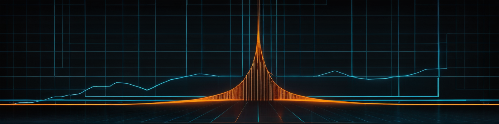

  

<h2 align="center">Hey, I'm Ran 👋</h2>

<b>AI Engineer · Building AI Agents & LLM Applications · ML Research</b>

---

### 🚀 Featured Projects

- 🎨 **DiffusionCraft** – Serverless AI image-generation platform on AWS using Stable Diffusion.
- 👁️ **VigilantEye** – Real-time computer-vision pipeline in C++17: YOLO detection, lightweight tracking and HUD overlay.
- 🧪 **kraken-api-qa-automation** – Automated API testing framework in Python and pytest.
- 🏥 **Clinical ML Research** – Predicting psychiatric readmission from 8,000+ hospitalizations (AUC 0.815), with Lev HaSharon Medical Center.

---

### 🧠 Currently Focused On

`AI Agents` · `Claude Code & Claude API` · `LLM Security` · `Modern C++`

### 🛠 Tech

`Python` · `C++17` · `AWS` · `Machine Learning` · `pytest`

---

### 🌱 Outside of Code

- Learning **Spanish**
- Travel and exploring new places
- Generative art with **Stable Diffusion**
